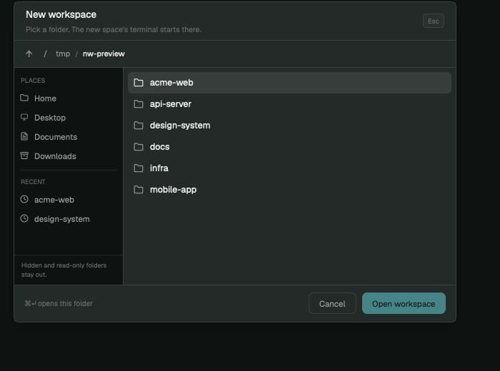

# New workspace

A native folder dialog for new spaces. Pick a folder, press **Open workspace**, and Herdr makes a space whose terminal starts in that folder. The dialog is one GPUI mod: no web view, no second process, no polling.



## What you see

A 620×450 dialog in the app's theme colors.

- **Header** — `New workspace` in 13.5 px semibold, with the line `Pick a folder. The new space's terminal starts there.` in 10.5 px muted. An `Esc` keycap sits at the right.
- **Path bar** — a 26 px up button and clickable breadcrumbs. Home shows `~`; a deep path keeps the last three folders. At the filesystem root the crumbs read `/ tmp / name`, not `//tmp/name`.
- **Places sidebar** — 152 px wide, `chrome` background. `PLACES` lists Home, Desktop, Documents and Downloads. `RECENT` lists the last five folders, newest first. A footnote says `Hidden and read-only folders stay out.`
- **Folder list** — 30 px rows with a 14 px folder icon and a 12.5 px name. The highlighted row uses `selected`; hover uses `hover`. A 3 px scrollbar appears only when the list overflows.
- **Footer** — the hint `⌘↵ opens this folder`, then `Cancel` and the primary `Open workspace` button. On a read-only folder the hint changes and the primary button is disabled.

## How it behaves

- **Open** — `⌘N` or `⌘⇧N` (the shipped `keys.json` snippet maps both to `mod.open:new-workspace`).
- **Navigate** — click a folder to enter it. `↑` / `↓` move the highlight, `Enter` enters the highlighted folder, `Backspace` or `⌘↑` goes to the parent, `⌘Enter` opens the current folder. `Esc` closes.
- **Breadcrumbs** — click any shown segment to jump there.
- **Places and recents** — click to jump. Recents merge the persisted `new-workspace.recents` list with the folders of the local spaces already open.
- **Start folder** — the last folder opened here, else the active space's folder, else `~`. A missing last folder falls back to `~`.
- **Open workspace** - stores the folder in `new-workspace.recents` and `new-workspace.last`, closes the dialog, and runs `space.new { folder, machine: "" }`. The empty machine forces this computer, because the folder list is local. Herdr names the space from the folder and starts the default shell there.
- **Read-only folders** — the folder list asks the shell for entries it can write to. A folder without write permission is not listed. If the current folder itself is read-only, the list still shows its writable children, but `Open workspace` is disabled.

## Built from

- One mod folder, `mods/new-workspace/`, with `place: "none"` and a `dialog` overlay of 620×450. No layout file.
- `logic.js`: pure decisions (`normalize`, `parentOf`, `nameOf`, `crumbs`, `places`, `recents`, `remember`, `parseListing`). It imports neither Herdr nor GPUI, so `logic.test.js` runs with Node alone.
- `herdr`: `exec`, `home`, `spaces`, `shared`, `setShared`, `theme`, `window`, `props`, `run`, `closeOverlay`.
- `gpui-kit` / `gpui-base`: `View`, `div`, `svg`, `v_flex`, `h_flex`.
- One `exec("/bin/sh", ["-c", LIST, "sh", folder])` per folder. The script prints `W` or `R` for the folder's own write access, then one NUL-terminated name per writable subfolder. Dot-folders never match `*/`.
- Commands: `space.new { folder, machine: "" }`.
- Shared keys: `new-workspace.last`, `new-workspace.recents`.
- Icons: `mods/files/folder.svg`, `mods/workspace-chrome/{monitor,file-text,archive,clock}.svg`.

## Watch out

- **Local folders only.** The dialog runs `sh` on this machine. Remote spaces are not listed.
- **The sidebar `+` is not changed here.** Herdr's shipped `spaces` mod calls `space.new` directly. Install [Spaces plus](../spaces-plus/) to point that `+` at this dialog; the key binding works without it.
- **Merging `keys.json` replaces `⌘N`.** Back up `~/.config/herdr-app/keys.json` first. `⌘⇧N` is an extra binding, not a replacement.
- **No name field.** The space takes Herdr's automatic name from the folder.
- **No search field.** Folders are browsed, not typed. The path bar and Places cover the usual jumps.
- **Recents can hold deleted folders.** Opening one shows `Cannot open that folder.` and leaves the current folder in place.
- **Write access is `test -w`.** It follows the person's effective permissions, including ACLs. A folder the person can read but not write is hidden, as asked.
- **The list is not virtualized.** It draws every folder in the current directory. Workspace folders are few; a directory with thousands of writable subfolders is the case to revisit.
- **Runs programs and reads folders.** It does not use the network and writes nothing outside Herdr's shared state.

## Done when

```sh
herdr-app check new-workspace/mods/new-workspace
cd new-workspace/mods/new-workspace && node --test logic.test.js
```

- The dialog opens on `⌘N`.
- At `/`, only writable folders such as `Applications` and `tmp` are listed; `System`, `Library` and `usr` are absent.
- `Open workspace` creates a space named after the folder and `hc ls --json` shows its terminal's `cwd` in that folder.
- `Esc` and `Cancel` close without making a space.
