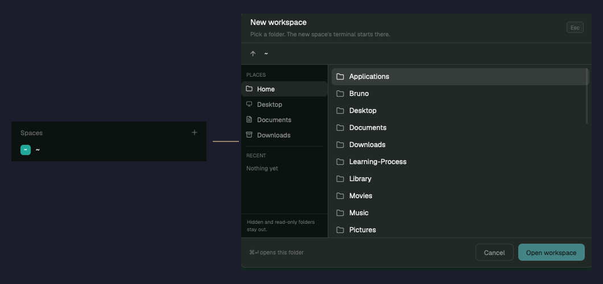

# Spaces plus

The shipped Spaces sidebar, with one change: the local `+` opens the New workspace folder dialog instead of making an empty space in your home folder. Pick a folder, confirm, and the new space's terminal starts there.



## What you see

The Spaces sidebar from Herdr core 0.1.13, unchanged: the `Spaces` header, the local and machine groups, the worktree rows, the space colors and drag-to-reorder.

- The header `+` at the right of `Spaces`.
- The local machine `+` in the `This computer` row, when more than one machine is known.
- The `New space there` row, when the local group has no space.

All three open the [New workspace](../new-workspace/) dialog: 620x450, the Places and Recent sidebar, the writable folder list, `Cancel` and `Open workspace`.

## How it behaves

- Click the header `+`: the dialog opens at the last picked folder, else the active space's folder, else `~`.
- Click the local machine `+` or `New space there`: the same dialog opens.
- Pick a folder. Click `Open workspace`, or press `Cmd+Enter`. The dialog stores the folder in `new-workspace.recents` and `new-workspace.last`, closes, and runs `space.new { folder }`. Herdr names the new space after the folder and starts its shell there.
- Press `Esc`, click `Cancel`, or click beside the dialog: no space is made.
- A `+` on a remote machine still runs `space.new { machine }` directly. The folder list covers this computer only.

## Built from

- `mods/spaces-plus/`: a clone of Herdr's shipped `spaces` mod at core 0.1.13. Make it with `herdr-app do mod.clone '{"name":"spaces","as":"spaces-plus"}'`. `mod.json` keeps `cloned_from`.
- The behavior delta against `mods/spaces/main.js` is one method and three call sites. `newSpace(machine)` runs `mod.open { name: "new-workspace" }` for the local case and `space.new { machine }` for a remote machine.
- `herdr`: `run`. The existing `openOverlay` import still serves the right-click menu.
- Requires [New workspace](../new-workspace/). That mod owns the dialog, its size, its keys and its folder browser.
- Layout: the sidebar block must point `content.mod` at `spaces-plus`. In the SWEG layout that is the block with id `spaces`. Keep `"id": "spaces"` so the layout state does not move.

```json
{ "id": "spaces", "type": "block", "content": { "mod": "spaces-plus" } }
```

## Watch out

- **This is a fork.** It copies the shipped `spaces` mod. App updates do not change it. Re-clone and re-apply the small delta when the sidebar changes.
- **The layout must point at the fork.** A copy of this mod with the default layout still shows the shipped `spaces` sidebar. Change `content.mod` to `spaces-plus`.
- **Local folders only.** The dialog runs `sh` on this computer. A remote machine's `+` keeps the direct `space.new` behavior.
- **One dependency.** Without the `new-workspace` mod, the click logs an unknown mod error and no dialog opens.
- **No keys.** This mod adds no key bindings. Merge the `new-workspace` snippet for `Cmd+N` and `Cmd+Shift+N`.
- **The click path is `mod.open`.** It opens the overlay that `new-workspace/mod.json` describes. The dialog size and kind stay in that one file.

## Done when

```sh
herdr-app check spaces-plus/mods/spaces-plus
herdr-app check ~/.config/herdr-app/mods/spaces-plus
herdr-app status
```

- `status` shows `"errors": []`.
- The sidebar still draws every space, machine group, worktree row and color.
- A click on the header `+` opens the `New workspace` dialog.
- `Open workspace` makes a space whose terminal `cwd` is the picked folder. Check it with `hc ls --json`.
- A click on a remote machine `+` still makes a space there, without the dialog.
